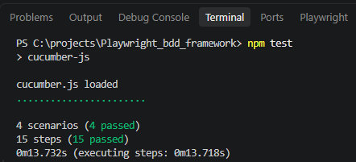
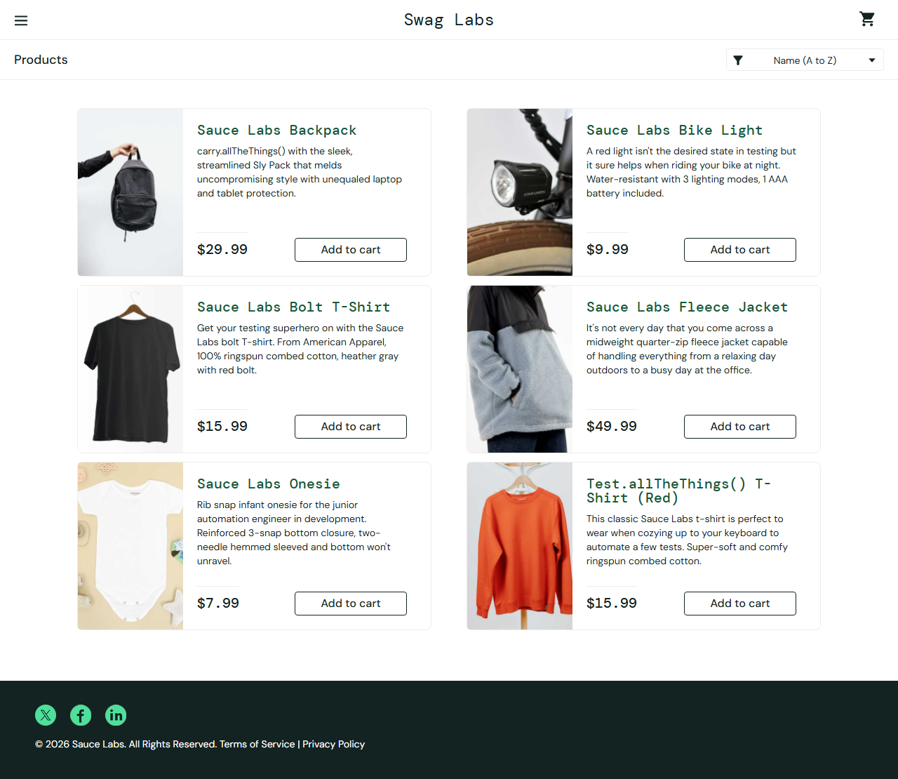
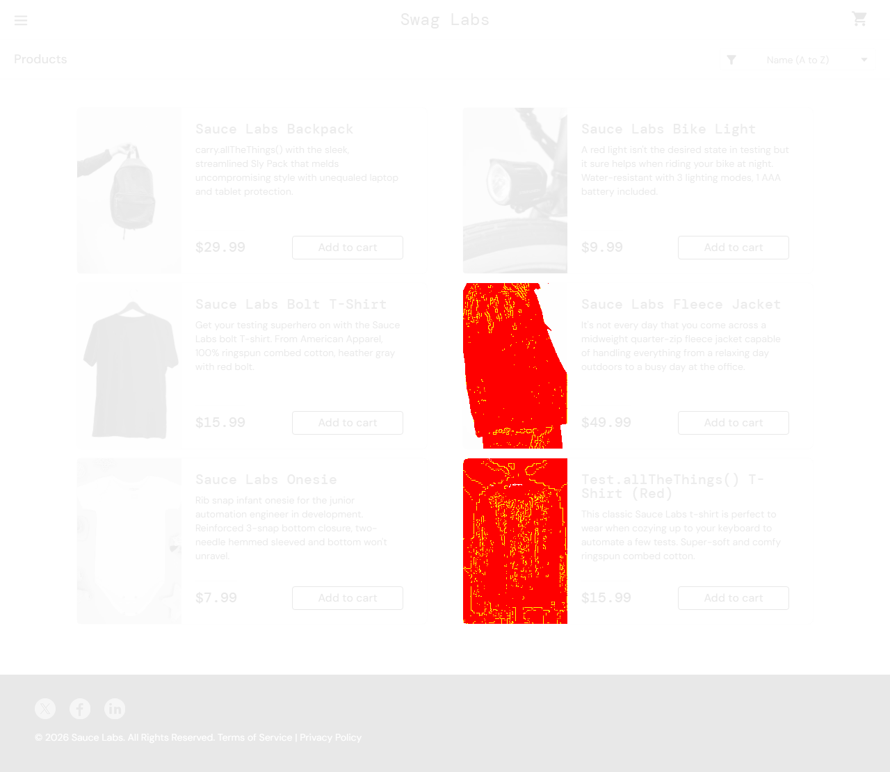

# Playwright BDD Automation Framework

A scalable end-to-end test automation framework built using Playwright, TypeScript and Cucumber BDD.

The framework demonstrates enterprise automation practices including:

- Page Object Model (POM)
- Behaviour Driven Development (BDD)
- Cross-browser testing
- API validation
- Visual regression testing
- Accessibility testing (Axe)
- Performance testing (Lighthouse)
- CI/CD integration
- Docker support

Target application:

https://www.saucedemo.com

---

# Architecture

```text
Playwright_bdd_framework
│
├── features
├── step-definitions
├── src
│   ├── api
│   ├── pages
│   ├── data
│   ├── support
│   ├── utils
│   ├── accessibility
│   └── performance
│
├── visual-baseline
├── visual-actual
├── visual-diff
│
└── .github/workflows
```

---

# Technology Stack

| Technology | Purpose |
|------------|----------|
| Playwright | UI Automation |
| TypeScript | Programming Language |
| Cucumber | BDD |
| Pixelmatch | Visual Regression |
| Axe | Accessibility Testing |
| Lighthouse | Performance Auditing |
| GitHub Actions | CI/CD |
| Docker | Containerised Execution |

---

# Key Features

## UI Automation

- Playwright
- TypeScript
- Page Object Model
- Reusable page components

## BDD

Feature files written in Gherkin.

Example:

```gherkin
Scenario: Validate inventory page

Given user logs in successfully

Then inventory page should load

And product inventory count is correct
```

## API Validation

Validates API responses against UI data.

Examples:

- Product count validation
- Product name validation
- Data consistency checks

## Visual Regression Testing

Baseline screenshots are stored within:

```text
visual-baseline/
```

Latest screenshots are stored within:

```text
visual-actual/
```

Differences are output to:

```text
visual-diff/
```

## Accessibility Testing

Uses Axe to identify:

- WCAG violations
- Accessibility rule failures
- Missing labels
- Colour contrast issues

## Performance Testing

Uses Lighthouse to validate:

- Performance
- Accessibility
- SEO
- Best Practices

---

# Cross Browser Execution

Supported browsers:

- Chromium
- Firefox
- WebKit

Execute:

```bash
npm test
```

or via GitHub Actions.

---

# Installation

Clone repository:

```bash
git clone <repository-url>
```

Install dependencies:

```bash
npm install
```

Install Playwright browsers:

```bash
npx playwright install
```

---

# Running Tests

Execute all tests:

```bash
npm test
```

Run Lighthouse tests:

```bash
npm run lighthouse
```

Generate Allure report:

```bash
npm run report
```

Open Allure report:

```bash
npm run report:open
```

---

# Visual Regression Workflow

1. Capture baseline screenshots
2. Store approved images in:

```text
visual-baseline/
```

3. Execute tests
4. Compare new screenshots
5. Generate diff images if mismatches are found

---

# CI/CD

GitHub Actions pipeline includes:

- Dependency installation
- Playwright browser installation
- Test execution
- Reporting
- Artifact publication

Workflow:

```text
.github/workflows/playwright.yml
```

---

# Docker Execution

Build image:

```bash
docker build -t playwright-framework .
```

Run tests:

```bash
docker run playwright-framework
```

---

# Future Enhancements

- REST API contract validation
- Visual masking support
- Percy integration
- Mobile emulation testing
- Database validation
- Azure DevOps integration
- Parallel test orchestration
- Slack notifications

---

# Author

Bright Maduka

QA Automation Engineer

Specialising in:

- Test Automation
- Playwright
- TypeScript
- CI/CD
- Quality Engineering

## Test Execution



## Visual Regression



